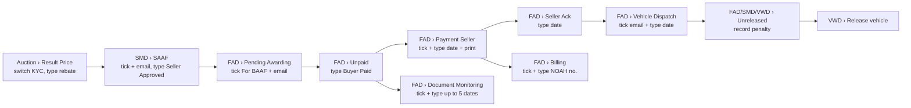
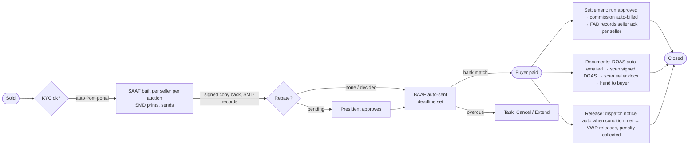

# CDMS Post-Auction: Konsep V2 "One Flow" (draft untuk review internal)

> **Status**: draft konsep, belum direview Yoshi-san / Alvin, belum dikirim ke JBAP.
> **Branch**: `concept/v2-one-flow` (dibuat dari `jbap-feedback-docmon-bond` @ 356bf9a). Prototype V1 milik Philips **tidak diubah sama sekali**; semua file V2 ada di folder `v2-concept/`.
> **Cara buka scratch UI**: double-click `v2-concept/index.html` (tanpa server). UI memakai shell CDMS yang sama dengan V1 (`../styles.css`, `../assets/`: sidebar CDMS MENU, logo, kartu biru, tabel), jadi folder ini harus tetap berada di dalam repo prototype. Data dummy anonim (Sample Buyer A–F, plat XAA/XEW).
> **Target push** (setelah disetujui): `philips-glitch/JBAP-CDMSCR`, branch `concept/v2-one-flow`.
> **Disusun**: 6 Nov 2026, Firman.

---

## 1. Kenapa ada V2

Kaneshima-san (pimpinan JBAP) menyampaikan lewat Yoshi-san bahwa beliau **tidak bisa approve requirement yang hanya memindahkan cara kerja Access ke CDMS** tanpa menelaah alur optimal atau cara kerja yang lebih baik. Yoshi-san meminta kita melakukan konsultasi yang sebenarnya dengan JBAP (khususnya Jonathan dan Kim) lalu **mengulang estimasi**.

Catatan internal yang sama menekankan tiga hal:
1. Fitur terlalu banyak dan **sama persis dengan Access**: alurnya masih alur Access, UI dan flow tidak membaik.
2. Banyak input masih **manual** padahal bisa dihitung, diisi otomatis, atau tercatat sendiri (misalnya tanggal approved tanpa harus centang).
3. Fitur harus menjadi **satu kesatuan flow**, bukan fitur terpisah satu per satu, supaya cerita kerja user lebih mudah.

Dokumen ini adalah usulan arah. **Belum ada yang diputuskan**; banyak poin bergantung pada pengecekan dan workshop (bagian 9–10).

---

## 2. Diagnosis prototype V1 (Philips, @356bf9a)

Ini bukan kritik ke Philips: V1 dibangun persis sesuai input yang kita terima (CR form + 5 ronde feedback JBAP). Masalahnya ada di **cara kita menerima input**, bukan di eksekusinya.

### 2.1 Fakta dari repo

| Temuan | Bukti di V1 |
|---|---|
| Menu = form Access | 39 layar, dikelompokkan per departemen (FAD 14, SMD 8, VWD 4) mengikuti frmFAD / frmSMD / frmVWD |
| Lot pindah list karena user mengetik tanggal | **21 field tanggal** diketik manual di grid (16 di list + 5 tanggal di Document Monitoring), belum termasuk tanggal di dialog (Payment date, Date Cancelled, New deadline, Change date) |
| Kolom Yes/No khas Access | **9 kolom centang**: For BAAF, For SAAF, For Dispatch Email?, For DOAS Email?, Print Payment to Seller, Print?, For Email?, Print Transmittal?, For Return |
| Approval berupa tanggal/teks yang diketik | SMD Manager Approved dan FAD Manager Approved diketik sebagai tanggal; Extend meminta teks "Approved by (FAD Manager)" |
| List duplikat | SMD Unreleased Unit = "the same live list as FAD, view only"; SMD Pending Awarding/Unpaid/Seller Ack/For Dispatch = snapshot legacy |
| Tidak ada tampilan per unit | Untuk tahu posisi satu lot, user harus mencari di beberapa list. Halaman customer ada, halaman unit tidak ada |
| Usulan LOGIQUE kecil dan mundur saat ditolak | P1 ditarik ("JBAP keeps the Access format"), P2 ditarik; sisanya pre-tick (P4), pre-tick SAAF (P5), badge hitungan (P6) |

### 2.2 Akar masalah

1. **Unit desainnya salah.** V1 mendesain *layar per departemen*. Yang sebenarnya dikelola JBAP adalah *perjalanan satu unit* dari terjual sampai dilepas.
2. **Tanggal diperlakukan sebagai input, bukan sebagai jejak event.** Di Access, satu-satunya cara mencatat "sudah terjadi" adalah mengetik tanggal. Di sistem, tanggal bisa tercatat otomatis saat aksi terjadi.
3. **Feedback diterima per butir.** Setiap ronde menghasilkan "JBAP asked X → built X", sehingga paritas dengan Access makin kuat. Requirement .md dan estimasi ±41 MD yang saya buat sebelumnya mengikuti pola yang sama, jadi **keduanya tidak valid lagi untuk V2**.

### 2.3 Modul CDMS yang sudah ada tapi tidak dipakai di V1

Di `jbap-cdms` sudah ada controller untuk: `PaymentCustomer`, `PaymentCustomerDigital`, `BankTransfer` (termasuk **import CSV mutasi bank**), `PaymentSeller`, `Billing`, `PartialPayment`, `CashierClosing`, `DocumentManagement` (status per dokumen + history), `Inventory` (history status), `Reminder`.

**Belum diketahui** apakah modul-modul ini aktif dipakai JBAP PH (git history repo hanya "Firt master Main", Jan 2026). Kalau aktif, banyak tanggal V1 bisa diisi dari data yang sudah ada, dan build berkurang. Ini cek pertama yang harus dilakukan (bagian 9).

---

## 3. Prinsip desain V2

1. **Satu unit, satu record, satu halaman.** Semua departemen melihat lot yang sama; tidak ada list duplikat.
2. **Tanggal adalah event, bukan input.** Tanggal tercatat saat aksi terjadi, oleh sistem, atau oleh satu klik/scan dari user CDMS. Mengetik tanggal hanya untuk koreksi (dengan alasan, seperti *Change date* di V1).
3. **Centang diganti trigger otomatis atau satu tombol aksi massal.**
4. **Approval = tombol** dengan identitas user dan waktu otomatis, dalam satu inbox.
5. **Tampilkan pengecualian dulu.** User melihat yang butuh keputusan (overdue, tidak cocok, terblokir), bukan semua data. Yang sedang menunggu pihak lain disembunyikan dan diingatkan otomatis.
6. **Seller dan buyer tidak membuka CDMS** (link CDMS tidak diekspos ke luar; masukan Calvin 12 Nov). Dokumen dari seller (SAAF bertanda tangan, acknowledgement, konfirmasi DOAS EWB) dicatat user CDMS dengan satu klik **per dokumen**, bukan mengetik tanggal per lot. KYC buyer dibaca dari buyer portal (sistem terpisah).

Setiap tanggal di V2 diberi label sumber: **Auto** (sistem atau buyer portal), **1-click** (staf menekan tombol), **Scan** (dokumen fisik), **Typed** (manual, harus mendekati nol).

---

## 4. Model inti: siklus hidup satu lot

### 4.1 V1: lot berpindah antar list departemen

### 4.2 V2: satu state machine, tiga track paralel setelah bayar

Pengecualian (Cancel, Return to Seller, Extension, Fee waiver) adalah cabang dari state yang sama, dengan approval di inbox yang sama.

---

## 5. Otomasi: setiap input manual V1 → mekanisme V2

Kolom **Kelayakan**: *Tinggi* = bisa dibangun di CDMS tanpa pihak luar; *Cek* = tergantung modul/integrasi yang belum diverifikasi; *Sepakati* = perlu keputusan bisnis JBAP atau kesediaan seller/buyer.

| # | V1 (manual) | V2 | Sumber tanggal | Kelayakan |
|---|---|---|---|---|
| 1 | KYC Status di-switch di Result Price | Diambil dari status KYC buyer (registrasi di jbap-revamp / API) | Auto | Cek: sumber dan definisi KYC |
| 2 | SAAF: centang For SAAF → Email per lot | SAAF **disusun otomatis per seller per auction** dari lot yang KYC-nya approved (layout form kertas sekarang, termasuk Minimum Bid Price); SMD cek winning bid price + buyer lalu **Checked & print** (cek tercatat) lalu **Mark sent to seller** sekali per form. Tanda tangan internal tetap di kertas, tidak dicatat | Auto + 1-click | Tinggi |
| 3 | Seller Approved diketik per lot | SMD klik **Record signed SAAF** sekali per form saat kertas kembali (untick lot yang tidak ditandatangani; lampirkan scan) | 1-click (opsi: scan QR di form) | Tinggi |
| 4 | Pending Awarding: centang For BAAF, cek Awarding Date | BAAF disiapkan otomatis saat KYC + SAAF beres, dikirim pada pengiriman 16:00; **ditahan otomatis** selama rebate menunggu President; Awarding Date = tanggal kirim | Auto | Tinggi |
| 5 | Buyer Paid diketik | Dicocokkan dari import mutasi bank / modul payment; hanya yang tidak cocok masuk ke FAD | Auto | Import & template CDMS existing (`template_btm.csv`: Last/First/Middle Name, Customer Account Number, Amount) dipakai apa adanya; yang baru hanya auto-assign by Customer Account Number + Amount. Cek: modul dipakai di PH? arti Customer Account Number |
| 6 | Unpaid lewat deadline diketahui manual | Reminder H-1 otomatis; lewat deadline muncul tugas **Cancel / Extend** | Auto + 1-click | Tinggi |
| 7 | Payment Seller: centang + ketik tanggal + print | **Settlement run** per seller, satu approval | 1-click | Cek: modul PaymentSeller; cara transfer ke seller |
| 8 | Seller Acknowledgement diketik per lot | FAD › My Tasks › **Record acknowledgement** sekali per seller (centang lot di dokumen) | 1-click | Tinggi |
| 9 | Commission Billing: centang + ketik NOAH no. + print | Dibuat otomatis bersama settlement run | Auto | Cek: integrasi NOAH (P3 V1) |
| 10 | Unpaid Billing: ketik Payment Date + CR | Dicocokkan dari mutasi bank seperti #5 | Auto | Cek |
| 11 | For Dispatch: centang email + ketik Dispatch Date | Notice disiapkan saat syarat release seller terpenuhi, dikirim pada pengiriman 16:00 | Auto | Tinggi |
| 12 | DOAS for signature: centang + email | Disiapkan saat lot dibayar, dikirim pada pengiriman 16:00 | Auto | Tinggi |
| 13 | 5 tanggal dokumen (Receipt of DOAS, signed DOAS JBAP/seller, docs JBAP, docs buyer) | Receipt of DOAS = waktu email; signed DOAS & docs = **scan QR transmittal**; docs ke buyer = saat release / tombol | Auto / Scan / 1-click | Sedang: perlu label QR di transmittal |
| 14 | Penalty: Record payment di FAD, lalu release di VWD | Penalty tampil dan ditagih di langkah release yang sama (cashier) | 1-click | Tinggi (Cek: CashierClosing) |
| 15 | Extend: ketik deadline + nama approver | Request di task → approve di inbox | 1-click | Tinggi |
| 16 | RTS: ketik tanggal SMD Manager / FAD Manager Approved | Approve button di inbox | 1-click | Tinggi |
| 17 | Rebate Paid diketik | Dipotong dari tagihan buyer, atau masuk settlement/refund run | Auto | Sepakati: aturan rebate |
| 18 | Security Bond: 6 tanggal | ORCR via scan; refund via run seperti #7 | Scan / 1-click | Sedang |
| 19 | Holiday diketik satu per satu | Import daftar resmi tahunan, admin konfirmasi | 1-click | Tinggi |
| 20 | Cancellation fee: centang email + ketik Date Paid | Ditagih otomatis saat cancel; dicocokkan dari mutasi bank | Auto | Cek: seperti #5 |

**Perbaikan aturan yang diusulkan (perlu konfirmasi JBAP):**
- **Pull-out deadline untuk seller DOAS** baru dimulai setelah signed DOAS diterima. Di V1, lot bisa masuk For Dispatch setelah Buyer Paid tetapi release diblok sampai DOAS kembali, sehingga buyer berpotensi kena penalty ₱500/hari untuk keterlambatan yang bukan salahnya. *Ini bacaan saya atas V1; perlu diverifikasi dengan JBAP.*
- **Unpaid after deadline** menjadi keputusan eksplisit (Cancel / Extend dengan approval), bukan lot yang diam di list.

---

## 6. Struktur layar V2 (scratch UI, di dalam menu CDMS)

V2 **bukan aplikasi baru**: semuanya ada di CDMS yang sudah berjalan, dengan sidebar CDMS MENU yang sama. Menu departemen **FAD / SMD / VWD tetap ada** (user JBAP sudah mengenalnya), tetapi isinya dipangkas. Layar yang berubah diberi tag hijau **V2** di sidebar; yang ditandai *as V1* memakai desain V1 apa adanya.

| Menu CDMS | Layar | Status | Isi |
|---|---|---|---|
| Customer | Customer Inquiry, customer page | Existing, diperkaya | Tab customer page membaca stage yang sama dengan unit (sumber yang sama untuk buyer portal) |
| Auction | Result Price | Existing, diubah | KYC dibaca dari portal (tidak di-switch manual); Request rebate; Cancel sale (fee tertagih otomatis) |
| Report | **Pipeline** | Baru | Unit per stage, KPI (overdue, penalty, piutang, hari sale→release), daftar semua unit |
| Report | Rebate Monitoring, Liability to Seller, Inventory Summary, Cancellation Monitoring | As V1 | Report formal yang dikirim ke pihak lain |
| Approval | **Approvals** | Baru (menggantikan Rebate Approval) | Satu inbox: rebate, fee waiver, extension, return to seller. Tombol Approve/Reject |
| FAD | **My Tasks** | Baru | Hanya pengecualian: pembayaran tidak cocok, settlement run siap, dokumen fisik untuk di-scan, serah dokumen |
| FAD / SMD | My Tasks › **Scheduled emails** | Baru | Email yang disiapkan CDMS (BAAF, reminder, DOAS, dispatch) dan akan terkirim pada pengiriman 16:00: Preview (layout email V1), Hold dengan alasan, Release hold, Send now |
| FAD | **Settlement Run** | Baru | Lot yang sudah dibayar buyer, per seller, nilai terhitung; satu approval membayar seller dan membuat commission billing |
| FAD | **Documents** | Menggantikan Document Monitoring | Tanggal tercatat dari email, scan QR, atau release; tidak ada tanggal diketik |
| FAD | Security Bond | As V1 | |
| SMD | **My Tasks** | Baru | Buyer/seller yang tidak merespons, unpaid lewat deadline (Cancel / Extend) |
| SMD | Return to Seller | As V1 | Approval manager pindah ke inbox |
| VWD | **My Tasks** | Baru | Unit siap/overdue pull-out; Release vehicle sekaligus menagih penalty |
| Payment | Bank Transfer | Existing, diubah | Import mutasi bank (modul CDMS existing) + matching otomatis ke lot / cancellation fee + daftar semua transaksi bank dari semua import (juga tampil di unit page dan customer page) |
| Master | Holiday List | As V1 | (+ import tahunan, belum di scratch) |
| (dari link plat) | **Unit page** | Baru | Satu halaman per lot: next action, timeline sale→payment, 3 track paralel, uang, history dengan sumber tiap tanggal |
| Log Activity | Log Activity | Existing | Semua event otomatis dan manual |

Total: 39 layar V1 → **21** (14 baru/berubah + 7 tetap *as V1*; SMD › SAAF berubah menjadi daftar form per seller). Tombol **Demo events** di header mensimulasikan event (import bank, SAAF bertanda tangan kembali, buyer KYC, hari kerja berikutnya); **V1 vs V2** membuka tabel perbandingan.

### 6.1 Pemetaan 39 layar V1 → V2

| V1 | V2 |
|---|---|
| Auction › Result Price | Tetap (layar CDMS existing); KYC tidak lagi di-switch di sini; tombol Request rebate / Cancel sale juga ada di Unit page |
| Approval › Rebate Approval | Approvals |
| FAD › Pending Awarding, Unpaid | Otomatis (BAAF, bank match); yang tersisa muncul di My Tasks (overdue, mismatch) |
| FAD › Payment Seller, Billing (Commission Billing, Billing Monitoring, Unpaid Billing) | Settlement run + matching otomatis; Billing Monitoring jadi filter/report |
| FAD › Seller Acknowledgement | FAD › My Tasks: Record acknowledgement per seller |
| FAD › Vehicle Dispatch (For Dispatch, RTS Approval) | Otomatis; RTS approval → Approvals |
| FAD › Unreleased Unit | My Tasks (VWD) + Unit page |
| FAD › Document Monitoring | Track Documents di Unit page + task Scan; list monitoring tetap ada sebagai filter Pipeline |
| FAD › Cancellation Billing & Payment | Otomatis saat cancel + bank match |
| FAD › Rebate Payable | Settlement/refund run (tergantung aturan rebate) |
| FAD › Security Bond | Track tambahan di Unit page (belum di scratch) |
| SMD › SAAF | SMD › SAAF (form per seller per auction: Print, Mark sent, Record signed); overdue → My Tasks |
| SMD › Pending Awarding, Unpaid, Seller Ack, For Dispatch, Unreleased (snapshot/duplikat) | Dihapus: semua lihat All units / Unit page |
| SMD › Return to Seller, SMD Manager Approval | RTS flow + Approvals |
| VWD › Unreleased Unit, Unreleased (Overdue), For Dispatch, For Return to Seller | My Tasks (VWD) |
| Report (7 layar) | Pipeline untuk harian; report formal yang memang dikirim ke pihak lain tetap (Rebate Monitoring, Liability to Seller, Inventory Summary, Cancellation Monitoring) |
| Customer › Customer Inquiry, Sales Actions, customer page | Customer 360 (tetap, diperkaya dari state yang sama) |
| Master › Holiday List | Tetap + import tahunan |
| Log Activity | Tetap untuk audit; per lot tampil di Unit page |

---

## 7. Perbandingan flow Philips (V1) vs V2

### 7.1 Ringkas

| Aspek | V1 (Philips) | V2 (konsep) |
|---|---|---|
| Unit desain | Layar per departemen (FAD/SMD/VWD) | Perjalanan satu unit + antrian kerja per role |
| Cara lot maju | Staf mengetik tanggal / centang lalu Save | Event: sistem, scan, satu klik per dokumen |
| Jumlah layar | 39 | 21 di scratch UI (14 baru/berubah + 7 *as V1*) |
| Field tanggal diketik | 21 (+ dialog) | 0 dalam alur normal; koreksi via Change date |
| Kolom centang "For …?" | 9 | 0 (trigger otomatis / aksi massal) |
| Approval | Campuran: tombol (Rebate) dan tanggal/nama diketik (RTS, Extend) | Satu inbox, semua tombol |
| Melihat status satu unit | Cari di beberapa list | Satu Unit page |
| Pengecualian (overdue, mismatch) | Tercampur di list; kolom merah | Muncul sebagai task dengan keputusan yang jelas |
| Peran seller & buyer | Pasif; staf mengetik tanggal per lot | Tetap tidak membuka CDMS; staf mencatat sekali per dokumen (SAAF, acknowledgement) |
| Paralelisme setelah bayar | Tersembunyi di list berbeda | Terlihat sebagai 3 track |

### 7.2 Skenario: satu lot normal (seller SBC) dari terjual sampai selesai

| Langkah | V1: sentuhan manual | V2: sentuhan manual |
|---|---|---|
| KYC | 1 (switch) | 0 |
| SAAF kirim + approval | 3 per lot (centang, kirim, ketik tanggal) | 3 per form (Checked & print, Mark sent, Record signed) |
| BAAF | 2 (centang, kirim) | 0 |
| Buyer Paid | 1 (ketik) + Save | 0 (bank match) |
| Payment to Seller | 3 (centang, tanggal, print) | ⅟n (satu approval per run) |
| Seller Ack | 1 per lot | 1 per seller |
| Commission billing | 3 (centang, NOAH no., print) | 0 |
| Dispatch | 2 (centang email, tanggal) | 0 |
| DOAS & dokumen | 1 centang + hingga 5 tanggal | 2 scan |
| Release | 1–2 (penalty di FAD, release di VWD) | 1 |
| **Total** | **±15–20 sentuhan, ±9 layar, 3 departemen** | **±3–4 sentuhan + bagian dari 1 run** |

Angka V2 adalah **target desain**, bukan hasil ukur, dan bergantung pada poin *Cek/Sepakati* di bagian 5.

### 7.3 Yang dipertahankan dari V1

V1 tetap sangat berharga sebagai **sumber aturan bisnis yang sudah tervalidasi JBAP**, dan bisa dipakai ulang hampir seluruhnya:
- Aturan dan kalkulasi: working days + holiday, deadline 3 hari kerja, penalty ₱500/hari Pasay, cancellation fee 10k dan pembagiannya, komisi/VAT/CWT per seller, Payable to Seller (cocok sampai centavo dengan Access), status Document Monitoring, status Inventory.
- Seller parameter (release condition, DOAS signing, transfer fee, security bond).
- Layout email dan report (BAAF, SAAF, dispatch, DOAS, Documents Release, transmittal, clearance).
- Validasi tanggal, Change date dengan alasan, dan Log Activity per field.
- Keputusan JBAP ronde 1–5 (Q1–Q84) tetap berlaku kecuali yang bertentangan langsung dengan prinsip V2. Yang bertentangan dicatat di bagian 10 sebagai keputusan ulang.

---

## 8. Dampak ke estimasi

Estimasi lama (preliminary 100–150 MD dari Alvin; ±41 MD bagian saya) **tidak dipakai untuk V2**. Komponen yang perlu diestimasi ulang setelah workshop:

| Komponen | Catatan |
|---|---|
| Core lot state machine + event log | Inti V2; menggantikan banyak list |
| My Tasks, Approvals inbox, Unit page, Pipeline | Lebih sedikit layar daripada V1, tapi tiap layar lebih "pintar" |
| Automation jobs (SAAF builder, BAAF, reminder, dispatch, DOAS email, billing) | Scheduler + template email (layout reuse V1) |
| Bank matching | Import + template sudah ada di CDMS (`BankTransferController`); yang dibangun: auto-assign by Customer Account Number + Amount, daftar transaksi lintas import, tampilan di unit/customer page |
| SAAF per seller | Builder form + print layout SAAF + upload signed copy |
| KYC source | Tergantung jbap-revamp/API |
| NOAH | Tergantung API NOAH (P3 V1) |
| QR transmittal + scan | Kecil kalau pakai scanner/kamera biasa |
| Migrasi data Access | Tetap ada seperti di V1 |

**Saya belum bisa memberi angka MD**: integrasi bisa menaikkan, pengurangan layar bisa menurunkan. Angka keluar setelah cek prod (9) dan keputusan workshop (10).

---

## 9. Pengecekan sebelum workshop (satu batch ke prod)

1. Modul CDMS yang aktif di JBAP PH: jumlah transaksi 3 bulan terakhir untuk PaymentCustomer/Digital, BankTransfer (import), PaymentSeller, Billing, DocumentManagement, Inventory, Reminder, CashierClosing.
2. Volume: lot terjual per minggu, % lot yang telat bayar, % yang cancel, total penalty per bulan.
3. Bagaimana buyer membayar sekarang (transfer bank / cash / digital) dan apakah ada referensi yang bisa dicocokkan (Buyer ID, lot, VA).
4. Sumber dan definisi KYC buyer di jbap-revamp/API.

Query-nya disiapkan terpisah setelah dokumen ini disetujui.

---

## 10. Agenda workshop dengan JBAP (Jonathan, Kim)

**Sesi 1, as-is (±2 jam):** telusuri satu lot nyata dari terjual sampai release. Catat siapa yang menyentuh, berapa lama tiap langkah, di mana sering salah atau terlambat, dan KPI yang JBAP pedulikan.

**Sesi 2, to-be (±2 jam):** tunjukkan scratch UI ini dan putuskan:
1. Boleh BAAF/dispatch/DOAS email disiapkan CDMS dan terkirim pada pengiriman terjadwal (usulan: 16:00) kecuali di-Hold? Jam berapa cut-off yang cocok?
2. SAAF (tanya ke Joel): bagaimana seller mengirim balik SAAF bertanda tangan (email scan / fisik / kurir)? Cek SMD sebelum print cukup winning bid price dan buyer (perkiraan Calvin)? Bisakah QR di form dipakai untuk mencatat saat kembali?
3. Pembayaran buyer bisa dicocokkan otomatis dari template import yang ada? *Customer Account Number* itu isinya apa, dan apakah ada di data customer? Bagaimana kalau satu transfer untuk beberapa lot?
4. Rebate: dipotong dari tagihan buyer atau dibayar terpisah?
5. Pull-out deadline seller DOAS mulai dari signed DOAS diterima (lihat bagian 5)?
6. QR di transmittal untuk penerimaan dokumen: bisa dijalankan di kantor/yard?
7. NOAH: ada API, atau tetap ketik nomor?
8. Report mana yang benar-benar dikirim ke pihak lain (harus tetap ada format formalnya) dan mana yang cukup jadi tampilan Pipeline?

**Keputusan ulang yang perlu diangkat terbuka:** beberapa permintaan ronde 1–5 secara eksplisit meminta format Access (misalnya P1 ditarik karena "JBAP keeps the Access format"). Arah dari Kaneshima-san berlawanan dengan itu. Workshop harus membuat keputusan ini eksplisit supaya tim operasional dan manajemen JBAP sepakat.

---

## 11. Risiko

| Risiko | Mitigasi |
|---|---|
| User operasional JBAP terbiasa Access dan menolak perubahan | Workshop melibatkan mereka; tunjukkan pengurangan kerja per lot; transisi bertahap |
| Otomasi salah kirim (BAAF/SAAF) | "Auto kecuali ditahan", preview harian, log lengkap, email tetap bisa diedit seperti V1 |
| Integrasi (bank, NOAH, KYC) tidak siap | Fallback 1-click per titik; desain tetap jalan tanpa integrasi, otomasi menyusul |
| Seller tidak tanda tangan untuk satu lot | Lot di-untick saat Record signed SAAF → task SMD (Cancel sale / Record approval) |
| Estimasi membengkak | Fase: (1) core state + tasks + auto email, (2) bank matching, (3) NOAH/QR |
| DOAS/dokumen tetap fisik dan notaris | V2 tidak mengubah proses fisik; hanya cara mencatatnya. E-signature untuk DOAS **tidak** diasumsikan (belum diketahui legalitasnya di Filipina) |

---

## 12. Isi folder dan cara review scratch UI

- `README.md`: dokumen ini.
- `index.html`: scratch UI di shell CDMS (memakai `../styles.css` dan `../assets/` milik V1). Bukan desain final.
- `PANDUAN-FITUR-V2.md`: penjelasan fitur V2 satu per satu (bahasa sederhana, dengan perbandingan V1 dan cara mencobanya).
- `build-standalone.py`: membuat satu file HTML mandiri (CSS dan gambar di-inline) untuk dikirim tanpa repo.

**Alur demo yang disarankan:**
1. **Home**: kartu SMD / FAD / VWD / Approval dengan jumlah task.
2. **FAD › My Tasks**, **SMD › My Tasks**, **VWD › My Tasks**: hanya yang butuh orang; yang menunggu pihak lain dilipat di bawah.
3. Klik plat **XAA1007** → Unit page: next action, timeline, 3 track paralel, penalty, uang, history dengan label sumber.
4. **Payment › Bank Transfer** → Import bank statement: 2 pembayaran cocok otomatis, 1 kurang bayar masuk FAD › My Tasks, cancellation fee lunas otomatis.
5. **Approval › Approvals** → Approve rebate: BAAF lot itu langsung terkirim (lihat Log Activity).
6. **FAD › Settlement Run** → Approve run: seller dibayar, commission billing terbentuk sendiri.
7. **VWD › My Tasks** → Release vehicle: penalty ditagih di langkah yang sama.
8. **SMD › My Tasks** → Cancel sale (dengan request waiver) → muncul di Approvals.
9. **Demo events** → SAAF bertanda tangan kembali, buyer KYC, next working day: lihat SAAF/BAAF/reminder berjalan sendiri.
10. **V1 vs V2** di header untuk tabel perbandingan.
